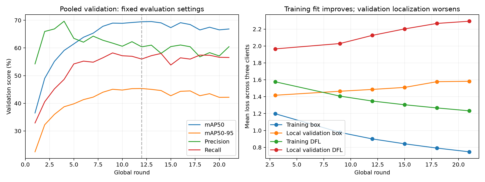

# Native YOLO decline analysis: rounds 1-21

Evidence: 21 full Drive round JSONs, 18 client training CSVs at rounds 3/9/12/15/18/21, frozen dataset manifests/labels, exact native runner, Ultralytics 8.4.48 source, and downloaded best/latest checkpoint tensors. No training, evaluation rerun or hyperparameter changes were performed. The held-out test was not used.

## Finding

The strongest supported diagnosis is deteriorating validation generalization, with an important localization component. This is consistent with overfitting after the useful early learning phase. A single exclusive causal explanation cannot be established from observational logs; optimizer schedule, augmentation and BatchNorm alternatives require controlled ablations.

Best pooled AP50-95 is round 12: 45.34%. Latest round 21: 42.18%, a decline of 3.16 percentage points. AP50 drops 69.47% to 66.86%. Precision barely changes (60.41% to 60.45%) and recall slightly increases (55.99% to 56.56%). Thus the post-peak decline is not primarily a continuing collapse of precision/recall.

## Loss evidence

| Round | Train box | Local val box | Train classification | Local val classification | Train DFL | Local val DFL |
| --- | ---: | ---: | ---: | ---: | ---: | ---: |
| 3 | 1.198 | 1.417 | 2.365 | 1.969 | 1.576 | 1.966 |
| 9 | 0.977 | 1.464 | 1.515 | 1.805 | 1.407 | 2.029 |
| 12 | 0.900 | 1.486 | 1.306 | 1.830 | 1.348 | 2.126 |
| 15 | 0.842 | 1.510 | 1.152 | 1.851 | 1.304 | 2.202 |
| 18 | 0.791 | 1.577 | 1.030 | 1.878 | 1.267 | 2.267 |
| 21 | 0.747 | 1.582 | 0.935 | 1.788 | 1.233 | 2.293 |

Local validation losses come from individual client fits before server averaging; they are not pooled global-model losses. Training uses augmented images while validation uses unaugmented images, so absolute loss levels are not directly comparable. Their opposing trends under unchanged settings support a generalization problem. Classification validation loss is not monotonically worsening; box/DFL validation losses show the clearer divergence.

## Classes behind the decline

| Class | AP50-95 at best round | AP50-95 at round 21 | Change (points) | Validation boxes |
| --- | ---: | ---: | ---: | ---: |
| Cauliflower_healthy | 77.19% | 55.92% | -21.27 | 41 |
| Cauliflower_bacterial_spot | 53.92% | 42.52% | -11.40 | 34 |
| Radish_black_leaf_spot | 39.43% | 30.19% | -9.23 | 105 |
| Groundnut_healthy | 81.88% | 73.46% | -8.42 | 77 |
| Banana_moko | 59.74% | 53.38% | -6.36 | 103 |
| Banana_bract_mosaic_virus | 76.62% | 72.39% | -4.24 | 80 |
| Groundnut_late_leaf_spot | 48.97% | 44.99% | -3.97 | 473 |
| Banana_sigatoka | 17.62% | 14.33% | -3.28 | 855 |
| Radish_healthy | 67.12% | 64.16% | -2.96 | 121 |
| Banana_healthy | 69.92% | 67.33% | -2.59 | 218 |
| Radish_downy_mildew | 17.09% | 14.74% | -2.35 | 287 |
| Radish_mosaic_virus | 17.50% | 15.27% | -2.23 | 206 |
| Groundnut_early_rust | 56.10% | 53.96% | -2.14 | 296 |
| Banana_insect_pest | 15.41% | 13.37% | -2.03 | 359 |
| Banana_panama | 23.95% | 22.17% | -1.78 | 335 |
| Groundnut_early_leaf_spot | 7.57% | 6.16% | -1.41 | 1202 |
| Banana_cordana | 30.77% | 29.66% | -1.11 | 482 |
| Groundnut_rust | 70.31% | 69.20% | -1.11 | 344 |
| Groundnut_nutrition_deficiency | 49.38% | 48.57% | -0.81 | 391 |
| Banana_pestalotiopsis | 6.30% | 5.74% | -0.56 | 373 |
| Banana_yellow_and_black_sigatoka | 39.62% | 39.21% | -0.41 | 674 |
| Cauliflower_black_rot | 82.83% | 85.93% | +3.10 | 19 |
| Radish_flea_beetle | 27.27% | 31.60% | +4.33 | 93 |
| Cauliflower_downy_mildew | 51.58% | 57.98% | +6.40 | 42 |

The four largest declines account for 2.10 points of the net 3.16-point macro AP decline. Small classes have equal weight in macro AP; small validation counts increase sensitivity to prediction changes. Validation images are fixed, so this is not sampling a different validation set every round.

## Confirmed training design limitations

- Each client receives the same current global floating tensors; transfer callbacks passed for all 63 completed client fits. All 14,514 training images are represented every global round.
- Every local fit is a fresh one-epoch native trainer. AdamW moments, scheduler, EMA state and local early-stopping history restart each fit. Learned global model weights do continue; the model is not restarting from COCO every round.
- Actual optimizer is AdamW. Auto selects initial LR 0.000357 for 24 classes; the configured lr0=0.01 is ignored. Three-epoch warmup lasts about 1,815 batches, while a one-epoch client fit lasts about 605 batches. The full warmup never finishes. Each fit ends at 0.0001188033 in all parameter groups; this is repeated every round, with no global-round LR decay. A lower nominal lr0 alone would not work while optimizer=auto stays enabled.
- Seed 42 is reset per native fit. This repeats the random initialization of the data pipeline; potentially repeating shuffle/augmentation patterns reduces their diversity. Exact augmented-image equality was not recorded, so it is not asserted.
- Mosaic probability is 1.0 and close_mosaic=10, but the local trainer sees epochs=1. The shutoff condition is local epoch -9 and never fires; the final global rounds do not get the intended unaugmented refinement stage. Persistent mosaic is a plausible contributor to train/validation localization mismatch, not proven to be the dominant cause.
- Native local patience=100 cannot stop a one-epoch fit, and no global early stopping is implemented. Therefore the run can continue after its validation optimum. Best checkpoint selection protects the useful model.
- Floating BatchNorm running statistics are averaged with model weights using the historical method. This can be a federated normalization concern; neither harmful BN mismatch nor client drift is established here. Client class image counts are relatively similar, so extreme class segregation is not a defensible diagnosis.

## Dataset and false-positive burden

At round 21, Banana_sigatoka contributes 960 false positives and Groundnut_early_leaf_spot 335: together 1,295 of 2,668 false positives (48.54%). Their AP50-95 values are 14.33% and 6.16%. This is a persistent performance bottleneck, distinct from the rare classes causing much of the post-peak macro AP decline.

Frozen label statistics show different localization scales: median validation box area is 1.63% of image area for groundnut early leaf spot and 4.78% for banana sigatoka, versus 79.77% for cauliflower healthy. Training groundnut early-leaf-spot boxes are below 1% of image area in 36.61% of cases, versus 19.72% in validation. These differences show scale/domain difficulty; they do not establish incorrect labels. Mosaic can further shrink lesions. Inspect actual annotations before changing labels, resolution or removing a class.

Class imbalance is substantial: cauliflower black rot has 59 training images, versus 1,953 for banana yellow-and-black sigatoka. Every class is represented in all three clients, so wholesale class segregation is absent. The earlier duplicate/leakage audit was enforced; semantic annotation quality remains a separate question.

At rounds 12 and 21, individual local-client AP50-95 values in training CSVs are below the aggregated global model native AP on the corresponding client splits. These observations do not support claiming that averaging is universally damaging this run. Client drift and BN mismatch remain unisolated hypotheses.

## Evaluation and integrity checks

- Same 4,157 images and 7,210 ground-truth boxes every round; micro precision/recall at confidence 0.25, IoU 0.50. AP uses confidence floor 0.001, NMS IoU 0.55 and max 100 predictions. These settings are unchanged. Counts reproduce reported precision/recall exactly.
- Both pooled COCO AP and native client AP decline after the peak; a fixed-threshold precision artifact alone does not explain this. Native precision uses a different aggregation/operating-point definition and must not be substituted into the pooled comparison table.
- Checkpoints 12 and 21 load with weights_only=True, have 24 class names, matching config hashes, finite floating tensors and positive BN variances. Round 21 file SHA matches latest.json. Round 12 SHA is recorded locally; its original expected SHA was not independently available in the metric record.
- Label syntax, class remapping and split-leakage checks were previously passed. This does not certify disease-name correctness, complete annotation coverage or consistent box tightness. Raw all-round predictions and client weight vectors were not retained, so no exact misclassification confusion audit or client-update angle audit was possible.

## Recommended action

Keep the current baseline unchanged if completing the promised 30-round experiment, and choose the best pooled validation checkpoint across all completed rounds. Do not replace round 12 with the latest checkpoint automatically. GPU termination during round 22 cannot explain the earlier round-13-to-21 decline; it only determines what is saved.

For a separate improvement branch starting from the validation-best model: first test a deliberately lower explicit AdamW rate with a global-round schedule and one-time warmup policy, against an unchanged control. Then independently test final-stage mosaic reduction and round-varying deterministic seeds. Inspect boxes and labels in the worst affected classes using validation data. Do not combine all changes at once or promise a performance gain. Test BatchNorm recalibration on training images only if the simpler ablations leave a localization gap. Use exactly the same pooled evaluator; reserve the test split for final reporting.

## Sources

- [Ultralytics 8.4.48 trainer source](https://github.com/ultralytics/ultralytics/blob/v8.4.48/ultralytics/engine/trainer.py): optimizer auto-selection, warmup, mosaic shutoff and final-epoch validation.
- [Ultralytics validation definitions](https://docs.ultralytics.com/modes/val/): native summary precision/recall operating point.
- [SCAFFOLD](https://proceedings.mlr.press/v119/karimireddy20a.html): heterogeneous-client drift is a general risk, not proof for this run.
- [FedBN](https://arxiv.org/abs/2102.07623): normalization under feature-shift heterogeneity is a general risk, not proof for this run.

