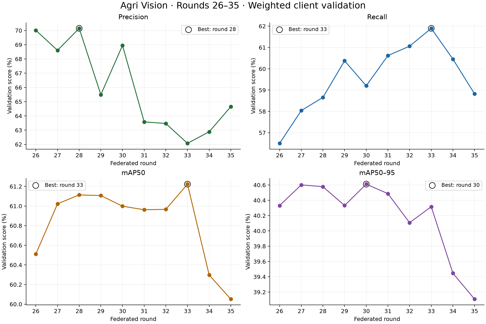
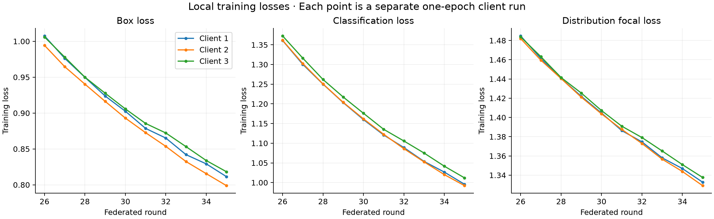

# Agri Vision: Detailed Report on Federated Rounds 26–35

Source archive: `20261002_121640_89aa17-20261003T102507Z-1-001.zip`. Analysis reads saved artifacts only; no training or detector evaluation was performed.

## Main findings

The archive confirms successful completion of ten additional federated rounds from a round-25 checkpoint. Metrics were saved in separate JSON files, rather than inside the global checkpoint. The latest checkpoint is not the highest-scoring checkpoint in this continuation.

Round 35: precision **64.65%**, recall **58.82%**, mAP50 **60.05%**, mAP50–95 **39.11%**. These are validation metrics averaged across clients, weighted by validation-image count; they are not held-out test results.

Best mAP50: round **33** (61.22%). Best mAP50–95: round **30** (40.61%).

## Run configuration and completion evidence

| Setting | Recorded value |
|---|---|
| Detector | YOLOv8n; project uses a 30-class detection head |
| Execution | Three-client sequential FedAvg simulation on one GPU |
| Starting checkpoint | global_round_025.pt |
| Additional rounds | 10 (26–35) |
| Local epochs | 1 per client per round; 10 additional epochs per client |
| Client training calls | 30; these are not 30 sequential epochs on one shared model |
| Image size / batch / workers | 640 / 8 / 2 |
| GPU | Tesla T4 |
| PyTorch | 2.11.0+cu130 |
| Recorded optimizer setting | auto; actual selected optimizer is not recorded here |
| AMP / deterministic / seed | true / true / 0 in each local training configuration |
| Local resume setting | false; model weights are loaded by the federated code, not a continuous optimizer resume |
| Final status | complete, round 35 |
| Final status timestamp | 2026-10-02T13:33:01.417888+00:00 |

Archive inventory: 142 files: 10 global checkpoints, 10 global metric JSON files, 30 local CSV files, 30 local argument YAML files, 60 local best/last checkpoints, settings.json, and status.json. All archive entries passed ZIP CRC verification. Every expected client-round result and checkpoint is present. The final status metrics exactly match metrics_round_035.json.

The standalone workspace global_round_035.pt is byte-identical to the archived round-35 checkpoint. A global checkpoint is 12,230,634 bytes (11.66 MiB); this serialized file size is not a measurement of network traffic.

## Global validation results by round

| Round | Precision | Recall | mAP50 | mAP50–95 |
|---:|---:|---:|---:|---:|
| 26 | 70.01% | 56.50% | 60.51% | 40.33% |
| 27 | 68.61% | 58.04% | 61.02% | 40.60% |
| 28 | 70.15% | 58.66% | 61.11% | 40.58% |
| 29 | 65.49% | 60.37% | 61.11% | 40.33% |
| 30 | 68.95% | 59.20% | 61.00% | 40.61% |
| 31 | 63.58% | 60.62% | 60.96% | 40.49% |
| 32 | 63.47% | 61.06% | 60.97% | 40.11% |
| 33 | 62.07% | 61.90% | 61.22% | 40.32% |
| 34 | 62.88% | 60.45% | 60.30% | 39.45% |
| 35 | 64.65% | 58.82% | 60.05% | 39.11% |

Definitions: precision measures correct detections among predicted detections; recall measures recovered labelled objects. mAP50 measures average precision at a box-overlap threshold of 0.50, while mAP50–95 averages stricter thresholds from 0.50 to 0.95. Saved precision/recall are detector summaries averaged within clients and then across clients; they are not pooled object counts.

The weighted mean of separate client AP values does not equal AP recomputed from all validation predictions together. Client-level global-model validation scores and counts were not retained separately in this archive, so the weighted aggregation cannot be independently reconstructed from these files.

## Trend and checkpoint selection

| Metric | Round 26 | Round 35 | Change (percentage points) | Best round | Best value |
|---|---:|---:|---:|---:|---:|
| Precision | 70.01% | 64.65% | -5.36 | 28 | 70.15% |
| Recall | 56.50% | 58.82% | +2.32 | 33 | 61.90% |
| mAP50 | 60.51% | 60.05% | -0.46 | 33 | 61.22% |
| mAP50–95 | 40.33% | 39.11% | -1.22 | 30 | 40.61% |

Across the ten rounds, mean mAP50 was 60.83% and mean mAP50–95 was 40.19%. mAP50 stayed near 61% for rounds 27–33 before declining in rounds 34–35. The final score was 1.17 percentage points below the best mAP50 and 1.50 points below the best mAP50–95.

If the declared primary selection metric is mAP50–95, round 30 is the candidate to retain. If it is mAP50, round 33 is the candidate. Round 33 also has the highest reported recall, but lower precision. The differences among rounds 27–33 are small; no repeated-seed experiments or confidence intervals establish statistically significant superiority. These rankings apply only to the rounds in this archive, not all rounds 1–35.

## Local client training results

The client CSVs describe individually trained local models before FedAvg. They must not be substituted for global-model validation. Although args.yaml sets val=false, the CSVs contain nonzero validation metrics and losses; the archive establishes that those values were emitted, but does not retain the console logs needed to confirm their exact validation execution path. A final-epoch validation is a possible explanation, not a verified finding.

| Client | Mean local mAP50 (26–35) | Round-26 local mAP50 | Round-35 local mAP50 | Round-35 local mAP50–95 |
|---|---:|---:|---:|---:|
| Client 1 | 56.51% | 56.32% | 54.57% | 33.26% |
| Client 2 | 56.00% | 55.92% | 56.86% | 37.81% |
| Client 3 | 57.64% | 58.48% | 56.13% | 35.15% |

These clients use different validation shards. Their differences may reflect shard difficulty, class support, and local training effects; they do not prove that one client is intrinsically better. The global model's mAP50 is higher than every local-model mAP50 recorded at the same round throughout this continuation, but shard-level global scores are unavailable for a paired comparison.

## Loss behaviour

| Client | Box loss: 26 → 35 | Classification loss: 26 → 35 | DFL: 26 → 35 |
|---|---:|---:|---:|
| Client 1 | 1.0076 → 0.8114 | 1.3611 → 0.9956 | 1.4848 → 1.3327 |
| Client 2 | 0.9943 → 0.7988 | 1.3615 → 0.9922 | 1.4820 → 1.3291 |
| Client 3 | 1.0060 → 0.8182 | 1.3727 → 1.0119 | 1.4838 → 1.3376 |

All three training-loss components decreased monotonically for all three clients. Nevertheless, global validation mAP declined at the end. This shows that improving training fit did not translate into continuing validation improvement. It is consistent with overfitting or federated optimisation effects, but these artifacts cannot identify a unique cause.

Local validation losses also increased between rounds 26 and 35 for all three clients and all three recorded components. This strengthens the evidence of a growing training-versus-validation gap, subject to the CSV validation-provenance limitation above.

Each client CSV records an epoch numbered 1 and the same final learning rate, 0.0000978485, in all three parameter groups. The local code creates a new one-epoch training call each round, so this is not a continuous ten-epoch optimizer/scheduler history. args.yaml records three warmup epochs even though each call trains for one epoch. The effect of optimizer restarts and warmup should be investigated before assuming that increasing rounds will help; this report does not claim they caused the decline.

## Runtime and resource evidence

The sum of the 30 recorded local epoch times is 3603.512 seconds (60.06 minutes). Individual client-epoch times range from 118.095 to 124.490 seconds. This covers the times emitted in local CSVs, not the whole run.

The interval from the run folder's timestamp (2026-10-02T12:16:40 assumed UTC) to the final status timestamp is 76.36 minutes. This is an approximate wall-clock interval inferred from naming, not a recorded timer. The difference from summed epoch times can include global validation, model setup, checkpoint writes, and Drive copies, but those components cannot be separated here.

The final CUDA allocations are only a post-run snapshot (0.031 GB allocated/reserved). They do not represent peak training GPU memory. Network traffic, energy, and inference latency were not measured. The single-GPU sequential simulation does not establish performance on three physically independent devices.

## What this archive cannot establish

- It contains no held-out test evaluation for these rounds. The existing round-25 report is a test report, so comparing its 57.01% test mAP50 with round-35's 60.05% validation mAP50 would not demonstrate improvement.
- It contains no round-25 validation metric file, so improvement relative to the starting checkpoint on matching validation data cannot be computed from this archive.
- No per-class global AP, confusion matrices, or prediction examples are retained. Claims that particular chili diseases improved or regressed would be unsupported.
- No per-client global validation breakdown, raw detections, or sample counts are saved with the metrics. Aggregation weights cannot be independently audited here.
- No centralized baseline, repeated runs, or alternative architectures are included.
- The exact training source code and Ultralytics version were not archived in this run. Workflow interpretation uses the current local project code and saved args/settings.

## Recommended next steps

1. Preserve all checkpoints. Select round 30 if mAP50–95 is the primary validation criterion, or round 33 if mAP50 is primary; document the choice before test evaluation.
2. Retrieve round-25 validation metrics from the original run if available, to measure the effect of this continuation on matching data.
3. Once a candidate is chosen, evaluate it on the held-out test split and retain per-class results, plots, and predictions. No such evaluation was run for this report.
4. For future runs, save individual client validation metrics and counts, package versions, actual optimizer choice, and timing information alongside the global summaries.
5. Investigate the late validation decline with controlled validation experiments. Further rounds alone are not justified by the observed trend.

## FYP-ready result statement

> Ten additional federated rounds were completed using three clients, one local epoch per round, and a YOLOv8n detector at image size 640 on a Tesla T4. The final round achieved validation mAP50 of 60.05% and mAP50–95 of 39.11%. The highest mAP50 was 61.22% at round 33, while the highest mAP50–95 was 40.61% at round 30. Although local training losses decreased throughout the continuation, validation performance declined in the last two rounds, indicating that additional training did not provide sustained generalisation gains. These results are validation-image-weighted averages of client metrics, rather than pooled held-out test performance.

## Exported artifacts

- rounds_026_035_global_metrics.csv: exact saved global summary values.
- rounds_026_035_client_metrics.csv: all 30 local CSV rows with client and round identifiers.
- rounds_026_035_validation.png / .pdf: global validation trends.
- rounds_026_035_training_losses.png / .pdf: local loss curves.
- analyze_rounds_026_035.py: reproducible archive-only report generator.
